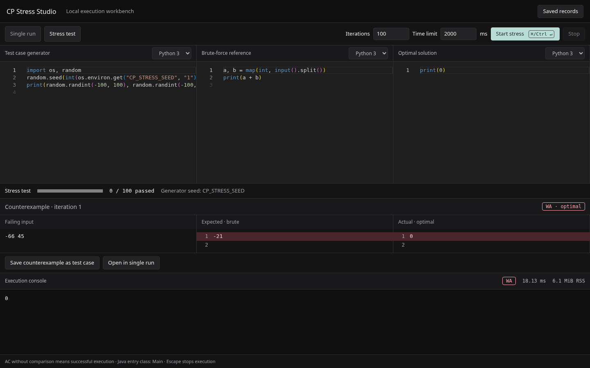

# CP Stress Studio

A local Electron workbench for running competitive programming solutions and finding counterexamples by comparing a target solution with a brute-force reference.



## Run locally

Requirements: Node.js 24 LTS and npm. Install the languages you use and make their commands available on the desktop app's `PATH`:

| Language | Toolchain | Source entry |
| --- | --- | --- |
| C++17 | `g++` | `main.cpp`; compiled with `-O3 -std=c++17` |
| Python 3 | `python3` | `main.py` |
| Java | JDK (`javac` and `java`) | `Main.java`, entry class `Main`, no package declaration |

```sh
npm ci
npm run dev
```

To run the built renderer with Electron:

```sh
npm run build
npm start
```

If a parent shell sets `ELECTRON_RUN_AS_NODE`, remove it before starting Electron. Browser preview does not have execution or database access. Desktop scripts run with your OS account's privileges: temporary working directories are **not an OS security sandbox**. Only execute code you trust.

## Single run

Choose C++17, Python 3 or Java, edit the solution, enter standard input and click **Run**. Enable **Compare** to check expected output. `AC` without comparison means the program exited successfully; it does not establish correctness. `Cmd/Ctrl+Enter` starts the selected run; **Stop** or `Escape` cancels it.

Verdicts: `AC`, `WA`, `TLE`, `RE`, `CE`, and `CANCELLED`. Compiler diagnostics, stderr, stdout, elapsed execution milliseconds and sampled memory are shown in the console. Python syntax failures are runtime errors because Python is launched directly.

## Stress test

Edit the generator, brute-force reference, and optimal solution independently. Set 1–10,000 iterations and a 50–30,000 ms per-process execution limit. Compiled programs are prepared once per stress session. Each iteration runs the generator, then reference and target with the same generated input. Comparison ignores whitespace differences but preserves token content and order.

`CP_STRESS_SEED` contains the one-based iteration number. Generators must explicitly use it for reproducible randomness; the built-in example does. A mismatch or execution failure stops the loop and records its role, exact captured input, expected output and actual output where available. Failures in the generator or reference are labeled separately from target failures.

Use **Save counterexample as test case** to keep a regression case, or **Open in single run** to debug it. Live progress counts only fully passed iterations.

## Saved records

**Saved records** contains workspaces/problems, test cases, execution history, and stress counterexamples. Save and update a named workspace to retain all editors and options. Load a test case, change its input/expected output in the workbench, then select it in the drawer and choose **Update selected test**. Records can be loaded, renamed and deleted; every collection also exposes create/read/update/delete through the validated preload API.

History and failing counterexamples are saved automatically, including the source snapshot used for the run. A persistence failure is reported without hiding the execution result. Deleting a workspace keeps its historical records and removes their association.

SQLite is stored at `app.getPath('userData')/studio.sqlite` using Node's built-in SQLite binding and WAL mode. There is no database server or Prisma generation step. The Day 1 Prisma packages remain installed but are not used by this persistence implementation.

## Execution contract and limits

- Source: at most 512 KiB per script; stdin: at most 1 MiB.
- Compilation: 30-second deadline. Compiler failure, absence or timeout produces `CE` with diagnostics.
- Execution: high-resolution wall time via `process.hrtime.bigint()`, excluding compilation.
- Output: combined stdout/stderr capped at 1 MiB; excess output produces `RE`.
- Memory: peak **sampled parent-process RSS**, in KiB, using `/proc` on Linux and `ps` on macOS. It is neither an enforced memory limit nor total process-tree memory. Very short runs or unsupported platforms return `null` (shown as unavailable).
- POSIX process groups are killed with `SIGKILL`; Windows uses `taskkill /T /F`. Cancellation also covers compilation. Managed temporary directories are removed after execution/compilation failures, cancellation, and normal app shutdown. An OS crash or forced termination of Electron itself can leave a temporary directory.
- Local programs can access files, network and other resources permitted to the current user. This application is not suitable as an untrusted-code server judge.

## Architecture

- `electron/execution/process.js`: process supervision, streamed output, resource telemetry, cancellation.
- `electron/execution/runner.js`: validation, isolated temporary directories, compilation, reusable prepared programs.
- `electron/execution/stress.js`: sequential comparison and counterexamples.
- `electron/database/db.js`: SQLite CRUD and restart persistence.
- `electron/ipc.js`: trusted-main-frame checks, per-window run ownership, persistence and shutdown drain.
- `electron/preload.js`: narrow context-isolated API and removable event subscriptions.
- `src/components/`: locally bundled Monaco editors, execution console, stress diff and records drawer.
- `src/hooks/useExecution.js`: run identity, subscriptions, cancellation and restored-result state.

Electron files use CommonJS through `electron/package.json`; React/Vite files remain ES modules. Vite's relative asset base and port 5173 are preserved. The production renderer has a content security policy, local Monaco workers, disabled Node integration, context isolation and a sandboxed preload. Navigation and new-window requests are blocked.

## Verification

```sh
npm test
npm run lint
npm run test:desktop
```

The desktop suite launches the **built Electron app** with an isolated database. It exercises C++ execution, live cancellation, stress mismatches, saved test cases, and reopening history/workspaces after restart. Linux tests use headless Ozone; `--no-sandbox` is test-only and is not added to the application's launch scripts.

The GitHub workflow runs on Linux and macOS with Node 24, Python and JDK 21. Java tests skip locally when `javac` is missing. See [the Day 2 / Day 3 audit](docs/day2-day3-audit.md) for scope and remaining release checks.

## Design attribution

UI principles were informed by [unslop](https://github.com/heydamir/unslop), by Damir Sokolovsky ([@heydamir](https://x.com/heydamir)), licensed CC BY 4.0. The product direction is a dense, keyboard-oriented developer workbench: quiet graphite surfaces, 1px borders, compact controls, monospace data, and color reserved for verdicts and output differences.
