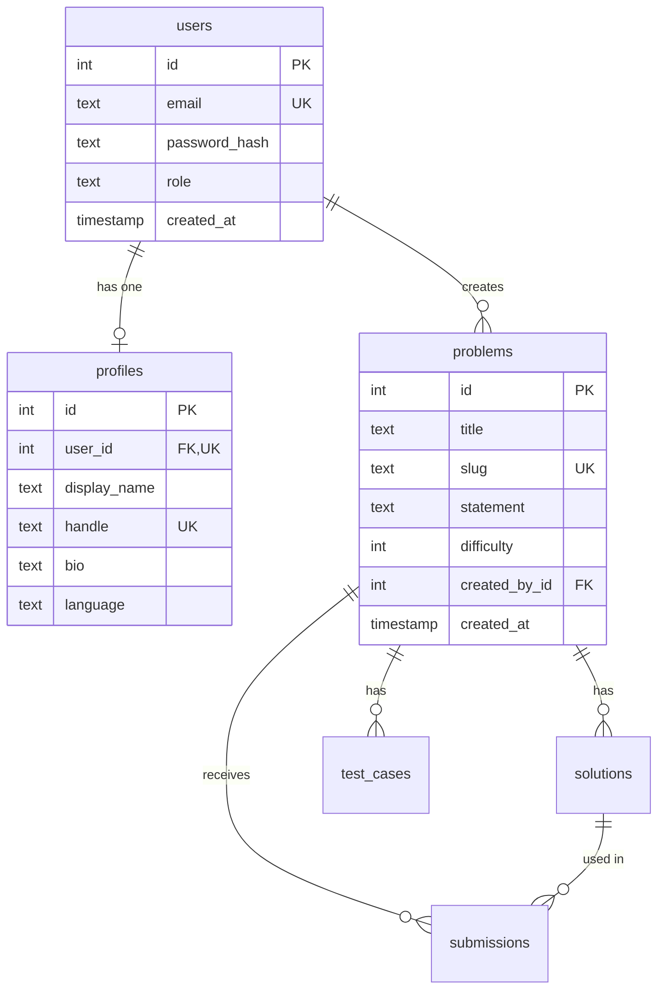

# Member 1: Normalization of users, profiles and problems

## 1. Tables and keys

| Table | Columns | Primary key | Other candidate keys | Foreign keys |
|---|---|---|---|---|
| users | id, email, password_hash, role, created_at | id | email | none |
| profiles | id, user_id, display_name, handle, bio, language | id | user_id, handle | user_id references users(id) |
| problems | id, title, slug, statement, difficulty, created_by_id, created_at | id | slug | created_by_id references users(id) |

## 2. Functional dependencies

**users**

- id -> email, password_hash, role, created_at
- email -> id, password_hash, role, created_at (email is UNIQUE)

**profiles**

- id -> user_id, display_name, handle, bio, language
- user_id -> id, display_name, handle, bio, language (user_id is UNIQUE, which makes the relation one-to-one)
- handle -> id, user_id, display_name, bio, language (handle is UNIQUE)

**problems**

- id -> title, slug, statement, difficulty, created_by_id, created_at
- slug -> id, title, statement, difficulty, created_by_id, created_at (slug is UNIQUE)

Two dependencies that do not exist, and why that matters:

- title does not determine anything, because two problems can share a title.
- created_by_id does not determine difficulty, title or any other problem column, because one user can create many different problems.

## 3. Normal form check

| Table | 1NF | 2NF | 3NF |
|---|---|---|---|
| users | Every column holds one atomic value. | All candidate keys are single columns, so no partial dependency is possible. | Every determinant (id, email) is a candidate key, so no transitive dependency. |
| profiles | Same. | Same, keys are id, user_id and handle. | Every determinant is a candidate key. |
| problems | Same. | Same, keys are id and slug. | Every determinant is a candidate key. |

Because every determinant in every table is a candidate key, all three tables are also in **BCNF**, which is stricter than 3NF.

## 4. Design decisions

- `role` is a plain text column limited by a CHECK constraint (`student` or `admin`). A separate roles table would add a join without removing any redundancy, so it would be over-normalizing.
- `handle` and `display_name` live in `profiles`, not in `users`, because they describe the person's public profile and not the login account.
- `slug` is kept next to `title`. It is a second candidate key, not a redundant copy, because the app looks problems up by slug.

## 5. ER diagram

Member 1 owns users, profiles and problems. The other tables belong to Member 2 and are shown only to explain how problems is referenced.

Cardinality:

- users to profiles is one-to-one, enforced by the UNIQUE constraint on `profiles.user_id`.
- users to problems is one-to-many, one user creates many problems.
- Deleting a user deletes the profile (`ON DELETE CASCADE`), but a user who still owns problems cannot be deleted (`ON DELETE RESTRICT`).

## 6. Example that breaks 3NF, and the fix

Suppose `problems` also stored the author's handle:

| id | title | created_by_id | author_handle |
|---|---|---|---|
| 1 | Two Sum Variant | 2 | admin |
| 2 | Sort the Array | 2 | admin |

Now `id -> created_by_id` and `created_by_id -> author_handle`, so `id -> author_handle` holds only through `created_by_id`. That is a **transitive dependency**, which violates 3NF.

Problems it causes:

- **Redundancy:** the handle is repeated for every problem by the same author.
- **Update anomaly:** changing a handle means updating many rows, and missing one leaves inconsistent data.
- **Deletion anomaly:** deleting a user's only problem would also lose the handle.

The fix is what the schema already does: the handle lives only in `profiles`, and `problems` keeps just `created_by_id` as a foreign key. A join (`problems JOIN profiles`) brings the handle back when needed.

